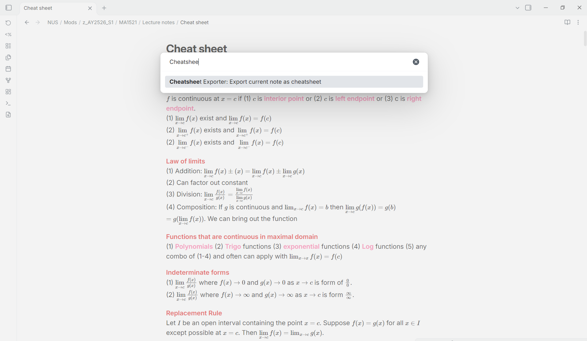
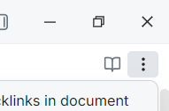
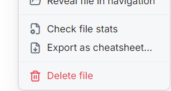

# Cheatsheet Exporter

Export your Obsidian note as a dense, double-sided A4 cheat sheet PDF for exams, made for college and university students.

Your theme, LaTeX, images and tables are kept, and nothing else needs to be installed.

## Demo

[](https://youtu.be/6KE7icNV5ho)

*Click the image to watch the 30 second demo on YouTube.*

## How to use

1. Install the plugin and **Enable** it under **Settings → Community plugins**.
2. Open the note you want to export. It has to be the note that is currently open.
3. Open the command palette with `Ctrl + P` on Windows or `Cmd + P` on macOS, then search for and run **Cheatsheet Exporter: Export current note as cheatsheet**.

   

   Alternatively, click the three dots in the top right of the note:

   

   then choose **Export as cheatsheet...**:

   

4. Pick your desired orientation and columns per side.
5. Adjust the font size until it fits, or press **Auto recommend** to fill in the layout that allows the largest font with nothing cut off. This could take a few seconds for large notes. I recommend at least 6 pt, otherwise the words are barely visible when printed.
6. Press **Export**. The PDF is saved next to your note as `<note name> - cheatsheet.pdf` and opens in your default PDF app.

## Printing

The sheet prints on white paper even if your theme has a coloured background, which saves ink. Turn on **Print theme background** to keep your theme's page colour. Highlights, code and callouts keep their colours either way. A theme with no light mode can print on a dark page or with faint text, so the dialog warns you to switch to a theme with a light mode first.

Print at **actual size**, not "fit to page", or the font size won't match what you chose. For double-sided printing, flip on the short edge for landscape and on the long edge for portrait.

## If your note doesn't fit

The plugin warns you but never changes your content to make it fit:

- A note too long for one sheet still exports in full, and the notice says how many sides it needs.
- Formulas or tables wider than their column get cut off on paper, and the dialog and notice say how many. **Use fewer columns or a smaller font.**
- **Force compact spacing** removes the margins and padding your theme adds, which often saves a lot of space, depending on your Obsidian theme and custom styling.

## Tips

- Start with Auto recommend, which picks the largest font that fits.
- Turn on Force compact spacing before lowering the font.
- More columns make lines narrower, which suits short lines but not wide formulas or tables.
- At 6 pt, keep the note under about 18,000 characters (shown in Obsidian's status bar).
- Split long formulas across lines with `aligned`:

  ```latex
  $$
  \begin{aligned}
  \operatorname{Var}(X) &= E[(X-\mu)^2] \\
                        &= E[X^2] - (E[X])^2
  \end{aligned}
  $$
  ```

- Keep tables to 2–3 columns, or use a list instead.
- Avoid deeply nested bullet points, since each level takes up column width.
- Use H4 headings or bold text instead of H1 and H2.
- Keep code lines short if your theme doesn't wrap code blocks.

## Compatibility and privacy

Desktop only, because PDF export uses Electron. It has been tested on Windows.

The plugin makes no network requests and has no accounts, ads or telemetry. It reads the note you export and writes the PDF into your vault. It doesn't read or write files outside your vault.

## Install manually

Download `main.js`, `manifest.json` and `styles.css` from the [latest release](https://github.com/Legalunicorn/obsidian-cheatsheet-exporter/releases/latest) into `<vault>/.obsidian/plugins/cheatsheet-exporter/`, then enable the plugin under **Settings → Community plugins**.

## Develop

```bash
npm install
```

```bash
npm test
```

```bash
npm run build
```

## License

[MIT](LICENSE). The bundled libraries, including [pdf-lib](https://github.com/cantoo-scribe/pdf-lib), are listed with their licences in [THIRD_PARTY_NOTICES.txt](THIRD_PARTY_NOTICES.txt).
